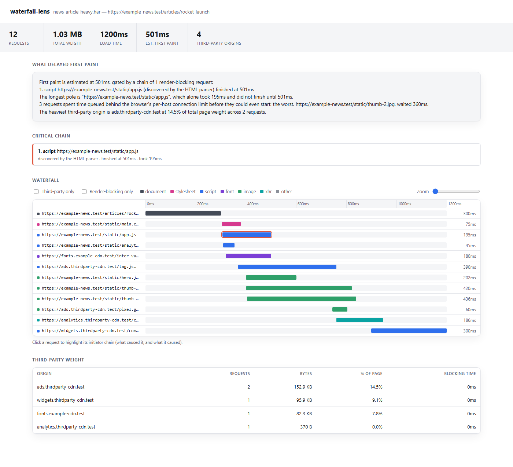
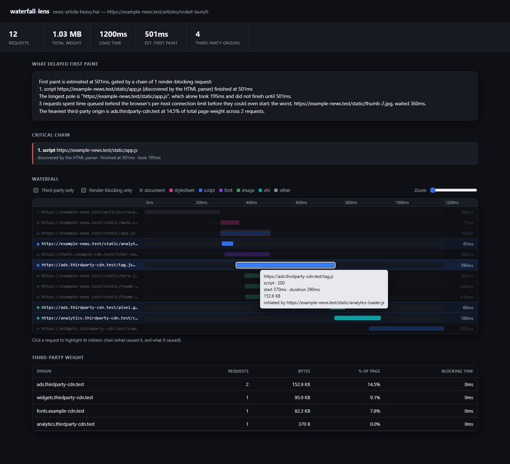

# waterfall-lens

**Turn a HAR capture into an answer, not another table.**

Every browser's DevTools already gives you a waterfall. What it doesn't give
you is the one sentence you actually want: *why was first paint slow, and
whose fault was it?* waterfall-lens parses a HAR file, reconstructs the
critical rendering chain by walking real initiator links, attributes page
weight to the third-party domains that caused it, and writes the answer in
plain English — next to an interactive waterfall you can zoom, filter, and
click through to verify it.

```
$ waterfall-lens analyze fixtures/news-article-heavy.har

waterfall-lens: news-article-heavy.har
12 requests, 1077363 bytes, load time 1200ms

First paint is estimated at 501ms, gated by a chain of 1 render-blocking request:
1. script https://example-news.test/static/app.js (discovered by the HTML parser) finished at 501ms
The longest pole is "https://example-news.test/static/app.js", which alone took 195ms and did not finish until 501ms.
3 requests spent time queued behind the browser's per-host connection limit before they could even start; the worst, https://example-news.test/static/thumb-2.jpg, waited 360ms.
The heaviest third-party origin is ads.thirdparty-cdn.test at 14.5% of total page weight across 2 requests.
```

## Why this exists

Waterfall viewers show you *what happened*. They rarely tell you *what
mattered*. A page can have 80 requests and only three of them actually gate
first paint — the rest are async scripts, lazy images, and analytics beacons
that arrived long before or long after the moment that counted. Re-rendering
the same 80-row table with prettier colors doesn't fix that. waterfall-lens
instead:

- **Reconstructs the critical chain**, not just "everything that's slow" —
  it walks `_initiator` links backward from whichever render-blocking
  response finished last, all the way to the navigation request, so you see
  *why* each step happened, not just *that* it happened.
- **Classifies render-blocking conservatively and says so.** HAR carries no
  `async`/`defer`/media-query metadata, so a script only counts as
  render-blocking when DevTools recorded it as parser-discovered
  (`_initiator.type === "parser"`) — scripts injected by other scripts are
  the common shape of async/defer loaders in practice. This is documented as
  a heuristic in the source, not oversold as an exact browser simulation.
- **Separates "slow" from "queued."** A request with zero DNS/connect/SSL
  time that still spent 300ms in `blocked` wasn't waiting on the network —
  it was waiting for a free connection slot behind five other requests to
  the same host. That's a completely different fix (bundle/preconnect) than
  a genuinely slow response, so it gets its own finding.
- **Attributes weight by domain, not by request.** One ad tag pulling in six
  requests from the same origin shows up as one line with a real percentage
  of total page weight, sorted so the heaviest offender is first.

## Quickstart

```bash
git clone https://github.com/hellpuffyt/waterfall-lens.git
cd waterfall-lens
npm install

# Print the plain-English explanation + summary
npm run dev -- analyze fixtures/news-article-heavy.har

# Generate the interactive HTML report (self-contained, no server needed)
npm run dev -- report fixtures/news-article-heavy.har --out report.html
```

No HAR file handy? Three realistic sample captures ship in `fixtures/` so
the demo works immediately:

| Fixture | Scenario |
|---|---|
| `news-article-heavy.har` | Article page with render-blocking CSS/JS, a connection-queued image gallery, and an ad/analytics third-party tail |
| `fast-marketing-page.har` | Lean, fast-loading page — near-instant first paint, no third parties |
| `minimal-single-request.har` | A single bare document response — the edge case with nothing to attribute |

Or point it at any real capture: open DevTools → Network → right-click →
**Save all as HAR with content**.

## The interactive report

`waterfall-lens report` writes one self-contained `.html` file — no server,
no build step, no external requests, works from `file://`.



Click any request to highlight its full initiator chain — everything that
caused it, and everything it in turn caused — dimming the rest of the
waterfall so the causal thread is unambiguous:



- **Zoom** the horizontal time axis from an overview down to millisecond
  detail; the time ruler scrolls in sync with the rows.
- **Hover** any bar for start time, duration, transfer size, status, and its
  initiator, without leaving the waterfall.
- **Filter** to third-party-only or render-blocking-only with one click.
- **Findings panel** at the top states the plain-English explanation before
  you've looked at a single bar.

**Untrusted input.** Every string in a HAR file (URLs, hostnames, initiator
URLs) is treated as untrusted: the report inserts them as escaped text, and
the embedded JSON escapes `<` so a URL cannot close the `<script>` block.
`test/hostile-input.test.ts` renders a HAR with HTML/script payloads in its
URLs and checks that nothing executes. Malformed files (truncated JSON,
unparseable `startedDateTime`, missing `response.content`) stop with a
one-line error and exit code 1.

**Scale.** A synthetic 20,000-entry capture is analysed in about 0.2 s by
the CLI; the generated report took about 2.4 s to load and about 1.2 s to
redraw after a click in headless Chromium on an Apple M5. The whole file is
read into memory, so multi-hundred-megabyte HARs (captures saved "with
content" of large media) need correspondingly more RAM.

## Architecture

```
   HAR file (JSON)
        │
        ▼
 ┌─────────────┐   structural validation, clear errors
 │  parser.ts  │   on truncated/non-HAR JSON
 └──────┬──────┘
        ▼
 ┌─────────────────────────────────────────────┐
 │  analyze.ts                                  │
 │  1. normalizeEntries — classify resource type,│
 │     compute timings relative to nav start,    │
 │     flag third-party, flag render-blocking    │
 │  2. attributeThirdPartyWeight — group by host  │
 │  3. findQueuedRequests — pure connection-queue │
 │     time vs. genuine network time              │
 │  4. buildCriticalChain — walk _initiator links │
 │     back from the latest-finishing blocker      │
 │  5. buildExplanation — render the above as       │
 │     plain English                                │
 └──────────────────┬────────────────────────────┘
                     ▼
        ┌────────────┴────────────┐
        ▼                         ▼
 ┌─────────────┐           ┌─────────────┐
 │   cli.ts    │           │   html.ts   │
 │ stdout /    │           │ self-       │
 │ JSON report │           │ contained   │
 └─────────────┘           │ interactive │
                           │ viewer      │
                           └─────────────┘
```

The engine (`analyze.ts`) is a pure function of `Har → WaterfallReport` with
no I/O, so it's exhaustively unit-testable against hand-built HAR shapes —
that's where most of the 117 tests live. `html.ts` then serializes the
report as embedded JSON and renders it with a small vanilla-JS layer (no
framework, no bundler, no CDN dependency at view time).

## API

```ts
import { loadHarFile, analyzeHar, renderHtmlReport } from 'waterfall-lens';

const har = loadHarFile('capture.har');
const report = analyzeHar(har, 'capture.har');
console.log(report.explanation);

const html = renderHtmlReport(report);
```

`WaterfallReport` (see `src/analyze.ts`) exposes the full structured
analysis — entries, critical chain, third-party attribution, queued
requests — for anything you want to build on top (CI budget checks, a
custom dashboard, etc.), not just the two built-in output formats.

## Development

```bash
npm run typecheck   # tsc --noEmit, strict mode
npm run lint        # eslint, zero warnings
npm test            # vitest, 117 tests
npm run coverage    # v8 coverage, thresholds enforced
npm run build       # emit dist/
```

CI (`.github/workflows/ci.yml`) runs all of the above across Node 20/22 on
Ubuntu, Windows, and macOS, plus a CLI smoke test against the built `dist/`
output.

## License

MIT © 2026 Prabesh Sharma — see [LICENSE](LICENSE).
